<div align="center">

# TrustPay

**Scam-proof payments for Instagram, WhatsApp and X vendors: the buyer's money sits in a Solana escrow until the parcel arrives, and every vendor carries an on-chain reputation nobody can fake.**

[](https://github.com/onepolymath/trustpay-escrow/actions/workflows/ci.yml)


[](LICENSE)

[**Live demo**](https://trustpay-sol.vercel.app) · [Threat model](docs/THREAT_MODEL.md) · [Demo script](docs/DEMO_SCRIPT.md) · [Submission](docs/SUBMISSION.md)

Built for the [Dev3pack Global Hackathon](https://hack.dev3pack.xyz) (Solana, Nov 2026).

> **Devnet status:** deployed. Program ID [`CvbRGAvMeDB3Up6fYa4xBX2GVdYdRKCpq4L5FLaThRBg`](https://explorer.solana.com/address/CvbRGAvMeDB3Up6fYa4xBX2GVdYdRKCpq4L5FLaThRBg?cluster=devnet) on Solana devnet, config initialised, live at https://trustpay-sol.vercel.app. The full flow is also verified end-to-end on a local validator (`pnpm e2e`).

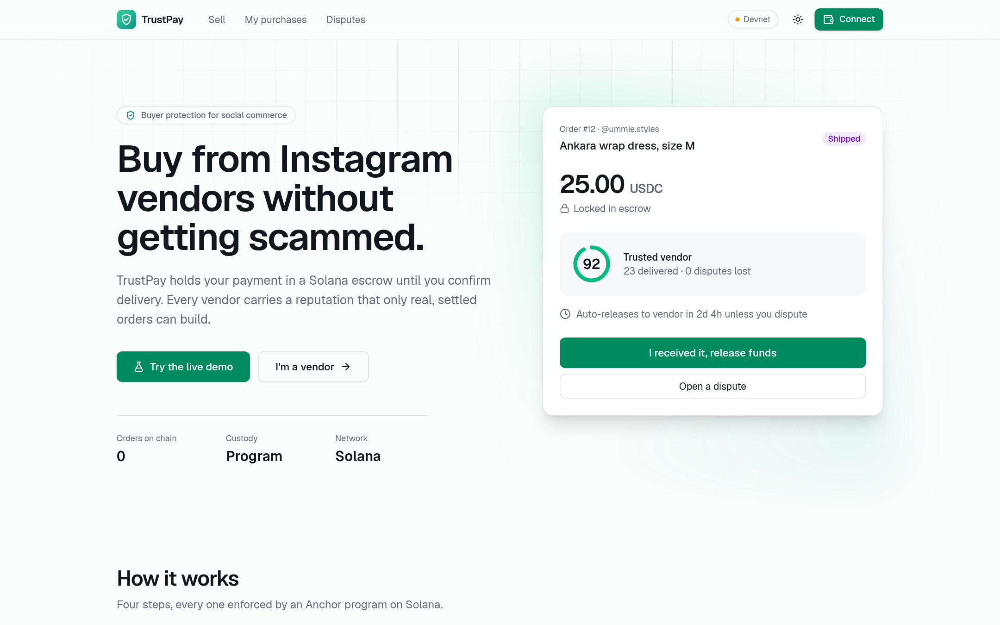

</div>

---

## The problem

Across Nigeria and the wider Global South, a huge share of retail happens in DMs. You see a dress on Instagram, message the vendor on WhatsApp, and send a bank transfer. Then:

- **Pay first, no delivery.** The vendor stops replying. This is the single most common online-shopping scam, and there is no recourse.
- **Fake payment screenshots.** Buyers "pay" with an edited bank alert and the vendor ships anyway.
- **Chargebacks and P2P disputes.** Card and P2P reversals hit honest vendors weeks later.
- **No way to tell who's legit.** Follower counts and testimonial screenshots are trivially faked.

Both sides lose trust, so honest small vendors lose sales.

## The solution

TrustPay replaces "send to my account" with a link.

1. **The vendor creates an order** (item, price, ship-by window) and shares it as a link, a **Blink** (pay right inside X or Discord) or a **Solana Pay QR** for WhatsApp.
2. **The buyer pays into escrow.** USDC moves into a token account owned by a program PDA. Nobody holds its key, not even us. The vendor can see it's locked, so fake screenshots are pointless.
3. **The vendor ships** and adds tracking, before the ship-by deadline.
4. **The buyer confirms delivery** and funds release to the vendor. If the buyer goes quiet, **funds auto-release** when the confirm window ends, so vendors are never held hostage.
5. **Something wrong?** The buyer opens a dispute before the window closes, which freezes the funds. An **arbiter** splits them between the two parties (and only them). If the vendor never ships, the buyer **reclaims everything** after the deadline.
6. **Every outcome updates the vendor's on-chain reputation**: delivered orders, refunds, missed shipments and lost disputes, rolled up into a trust score any buyer can check before paying.

| Vendor shares a link, Blink or QR                     | Buyer sees the vendor's record before paying             |
| ----------------------------------------------------- | -------------------------------------------------------- |
| 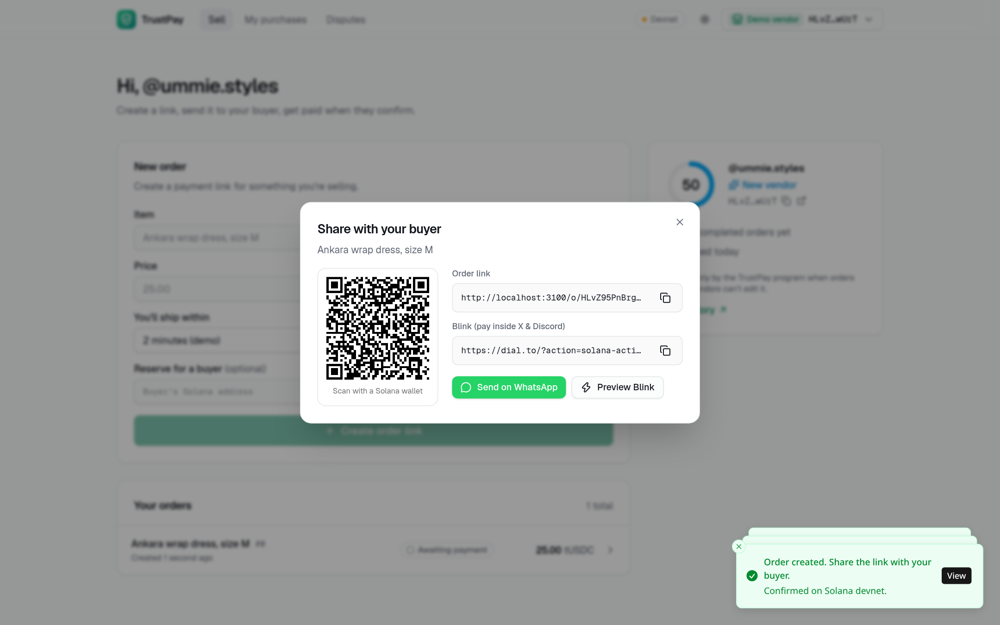          | 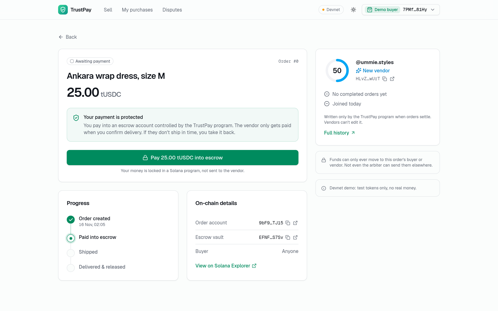   |
| **Dispute: funds frozen for the arbiter**             | **On-chain reputation**                                  |
| 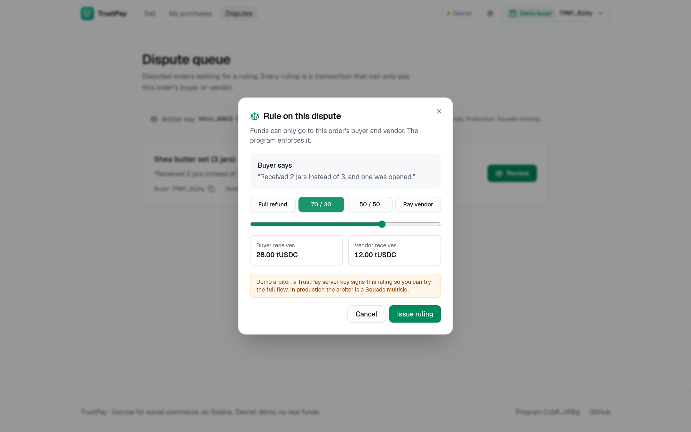 | 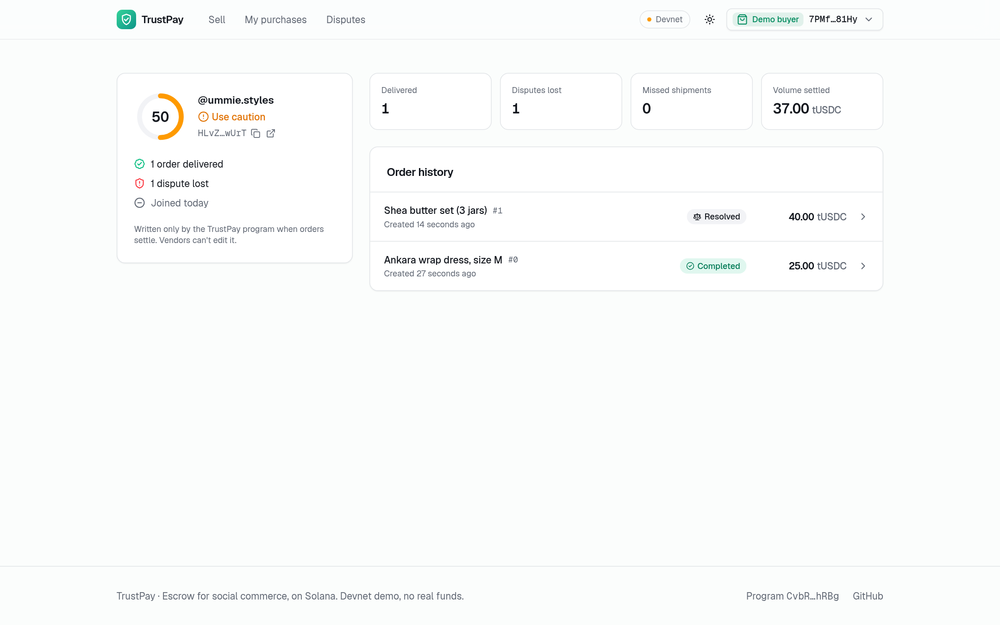 |

<details>
<summary>More screenshots (dark mode, mobile, full flow)</summary>

|                                                             |                                                          |
| ----------------------------------------------------------- | -------------------------------------------------------- |
| 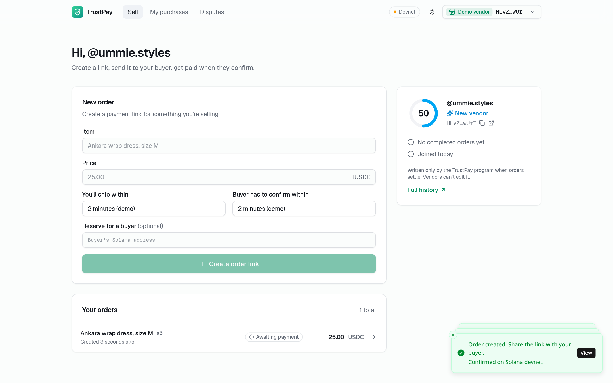       | 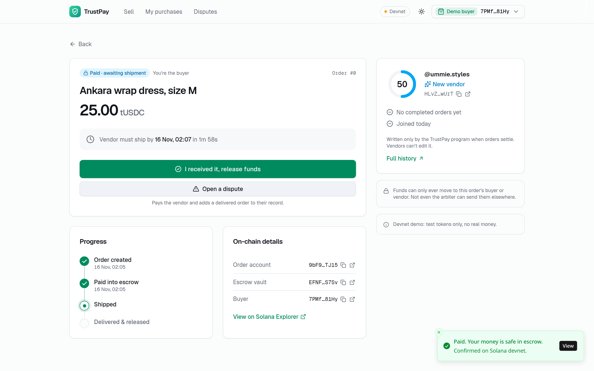      |
| 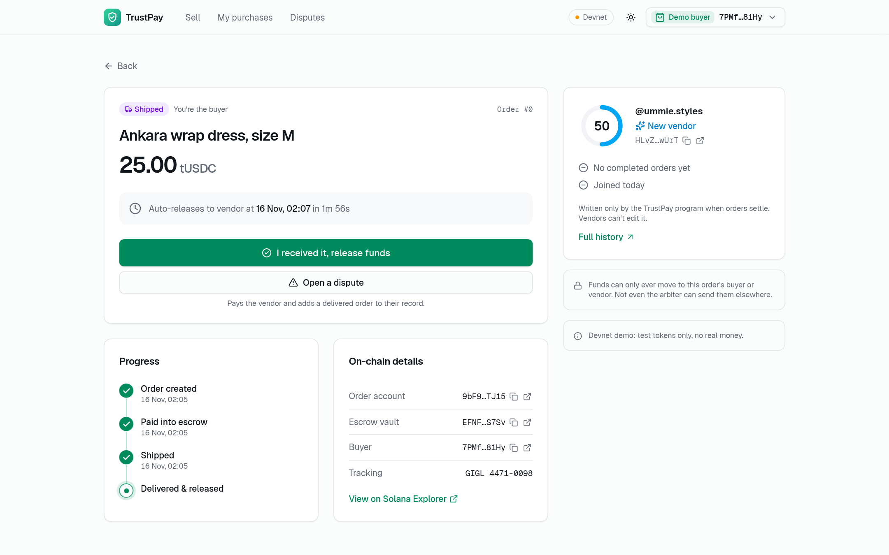        | 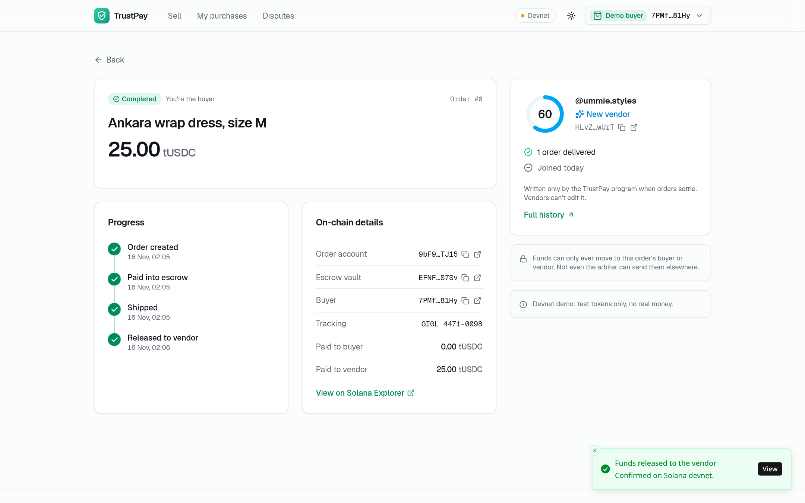   |
| 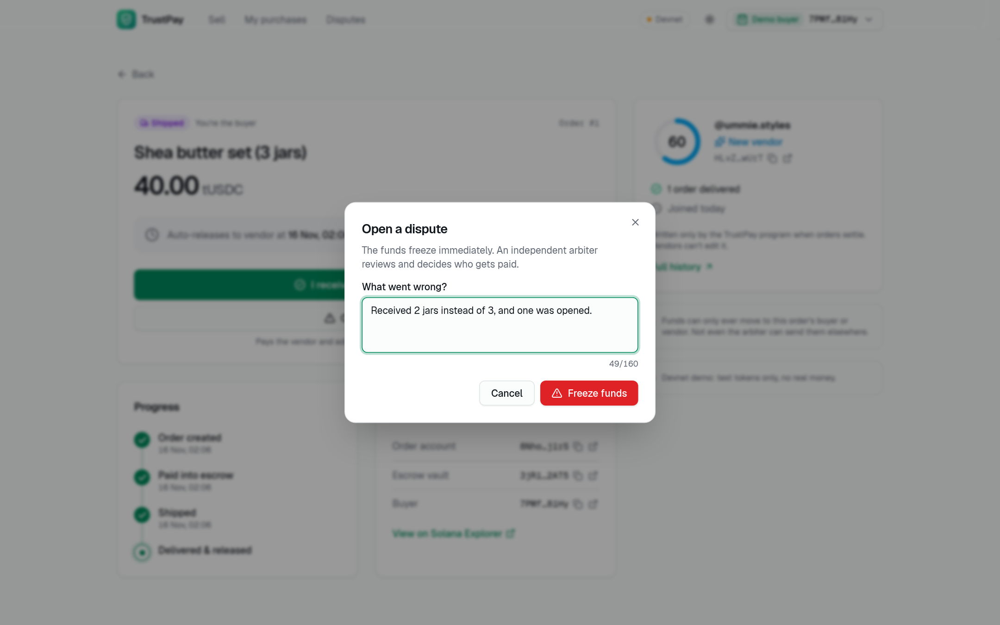       | 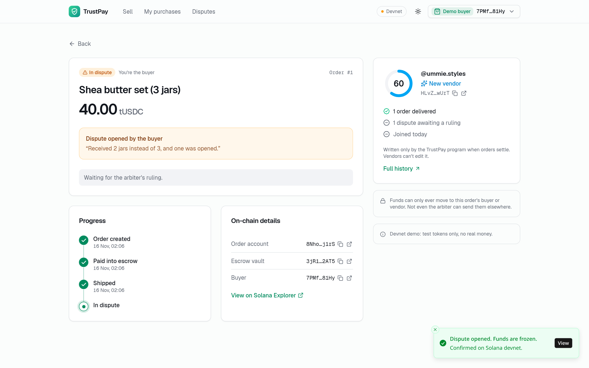    |
| 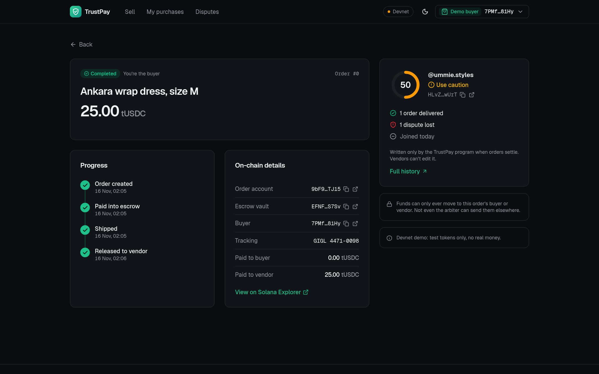 | 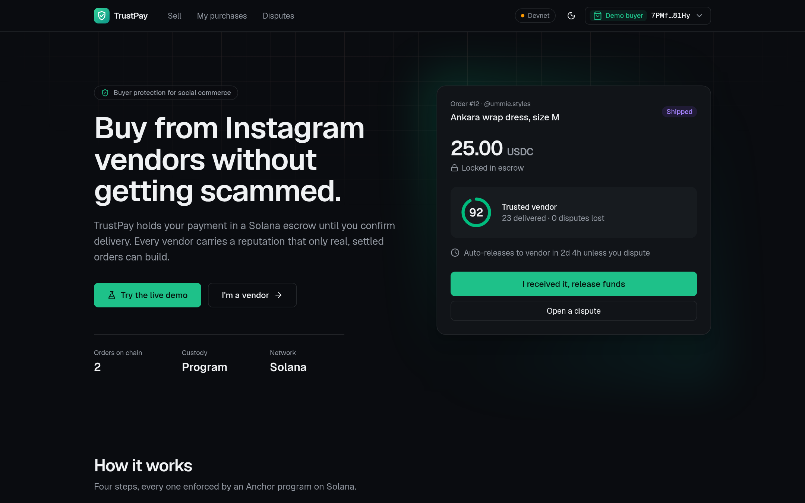         |
| 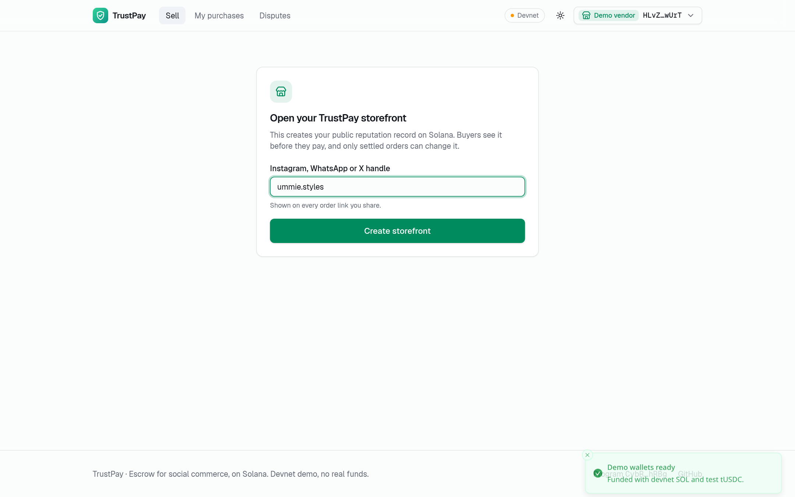             | 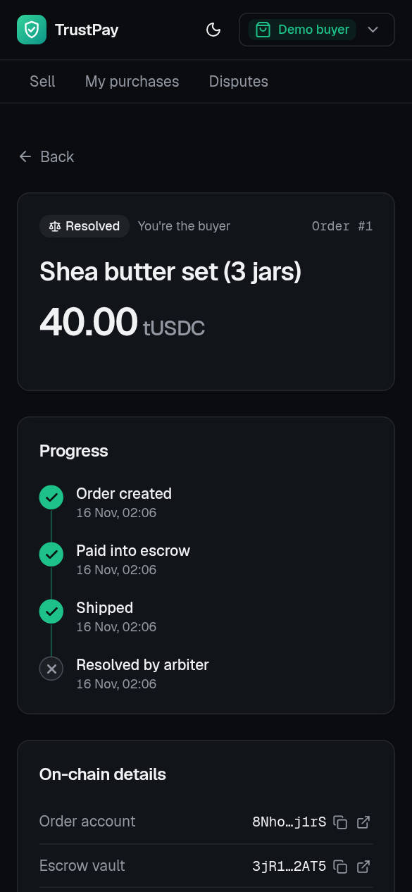 |

All screenshots are captured by the automated E2E run (`pnpm e2e`) against a real validator running the real program.

</details>

## Architecture

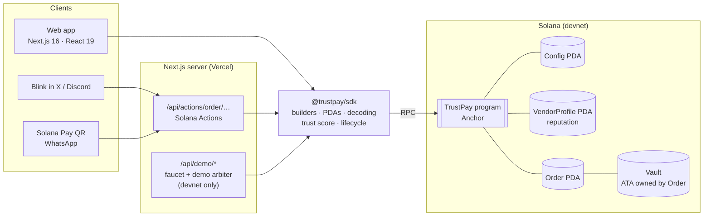

### Order state machine

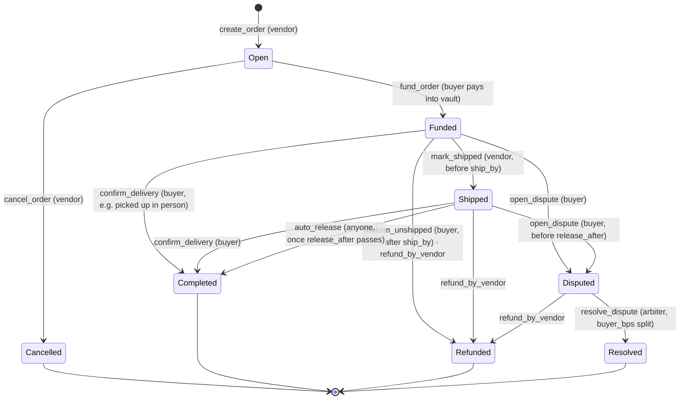

### Accounts

| Account         | Seeds                                  | Holds                                                                                                                            |
| --------------- | -------------------------------------- | -------------------------------------------------------------------------------------------------------------------------------- |
| `Config`        | `["config"]`                           | admin, arbiter, min/max window bounds. Initialised only by the program's upgrade authority.                                      |
| `VendorProfile` | `["vendor", vendor]`                   | handle and reputation counters: orders created, completed, refunded, missed shipments, disputes opened/won/lost, volume settled. |
| `Order`         | `["order", vendor, order_id (u64 LE)]` | parties, mint, amount, status, windows and deadlines, tracking, dispute reason, payouts.                                         |
| Vault           | `ATA(order, mint)`                     | the escrowed tokens. Closed on settlement, with rent returned to the buyer.                                                      |

### Repo layout

```
programs/trustpay/      Anchor program (13 instructions, 17 errors, events, Rust unit tests)
packages/sdk/           @trustpay/sdk: typed client, PDAs, decoding, trust score, lifecycle, links
  test/unit/            pure unit tests (vitest, 66)
  test/integration/     LiteSVM tests that run the compiled program (37 scenarios)
apps/web/               Next.js app: vendor console, buyer view, arbiter queue, reputation, Blinks
e2e/                    Playwright flow through the real UI (drives scripts/e2e-local.sh)
scripts/                build-program, bootstrap, deploy-devnet, e2e-local
docs/                   threat model, demo script, submission, screenshots
```

## Quickstart

**Prerequisites:** Node 22, pnpm 10 (`corepack enable`). For the program: Rust (pinned in `rust-toolchain.toml`), Solana CLI (Agave), Anchor 0.32.

```bash
git clone https://github.com/onepolymath/trustpay-escrow && cd trustpay-escrow
pnpm install

# Web app against devnet (uses the committed IDL, so no Rust needed)
cp .env.example apps/web/.env.local
pnpm dev                       # http://localhost:3000
```

### Run the whole stack locally (program + app + browser)

```bash
pnpm build:program             # cargo build-sbf + IDL -> packages/sdk/src/idl
pnpm e2e                       # local validator, bootstrap, production build, headless browser flow
```

`pnpm e2e` starts `solana-test-validator` with the program loaded as upgradeable, initialises the config, mints a test token, builds the web app in demo mode and walks through the full flow: register → create → share → pay → ship → confirm, then dispute → arbiter 70/30 → reputation.

### Deploy to devnet

```bash
# Keys live outside the repo. KEYS_DIR needs program.json, deployer.json (~4 devnet SOL), arbiter.json, funder.json
KEYS_DIR=~/trustpay-keys ./scripts/deploy-devnet.sh
```

The script deploys the program, runs `pnpm bootstrap` (initialises the config, creates the demo test mint, funds the demo arbiter) and prints the env vars for the web app.

## Testing

| Suite               | Command                  | What it covers                                                                                                                                                                                                                     |
| ------------------- | ------------------------ | ---------------------------------------------------------------------------------------------------------------------------------------------------------------------------------------------------------------------------------- |
| Rust unit           | `cargo test -p trustpay` | payout split maths, window bounds, the dispute/auto-release complement (10 tests)                                                                                                                                                  |
| Program integration | `pnpm test:program`      | **37 LiteSVM scenarios against the compiled `.so`**: config hijack, every lifecycle path, deadline edges, the timeout race, arbiter conflicts and redirection attempts, double-settle, stray tokens, reserved buyers, self-dealing |
| SDK unit            | `pnpm test`              | 66 tests: trust score, lifecycle/actions, PDAs, decoding, formatting, links, error mapping                                                                                                                                         |
| SDK coverage        | `pnpm test:coverage`     | unit + LiteSVM suites together, gated at 90% lines / 85% branches (currently 98.6% lines). Needs the built program.                                                                                                                |
| Web                 | `pnpm --filter web test` | Blink metadata, route param validation                                                                                                                                                                                             |
| E2E                 | `pnpm e2e`               | the full flow through the production UI on a real validator                                                                                                                                                                        |

CI runs format, typecheck, lint, unit tests and the web build on every push, plus a second job that builds the program with the Solana toolchain and runs the Rust suite and the LiteSVM suite with the coverage gate.

## Real vs mocked

| Piece                                              | Status                                                                                                                                                                                                                                                                                  |
| -------------------------------------------------- | --------------------------------------------------------------------------------------------------------------------------------------------------------------------------------------------------------------------------------------------------------------------------------------- |
| Escrow program, state machine, payouts, reputation | **Real**: Anchor program, Solana devnet                                                                                                                                                                                                                                                 |
| Blinks (Solana Actions) and Solana Pay QR          | **Real**: spec-compliant `actions.json` and action endpoints; the wallet signs a real `fund_order`                                                                                                                                                                                      |
| Browser wallets (Phantom, Solflare, Backpack…)     | **Real** via Wallet Standard                                                                                                                                                                                                                                                            |
| Demo wallets ("Demo buyer" / "Demo vendor")        | **Demo**: burner keypairs in your browser's localStorage so judges can try both sides without installing anything. Devnet only, clearly labelled, off unless `NEXT_PUBLIC_DEMO=1`.                                                                                                      |
| Payment token on the live demo (`tUSDC`)           | **Test token**: a devnet SPL mint we control, handed out by the demo faucet. The program works with any SPL mint (the default config is Circle's devnet USDC).                                                                                                                          |
| Arbiter                                            | **Demo**: on the live demo, the arbiter key is held by the server, so anyone can play arbiter from `/arbiter`. In production this would be a Squads multisig (see the roadmap). The program still guarantees the arbiter can only split funds between the order's own buyer and vendor. |

No real money is involved anywhere.

## Threat model (summary)

Full table with a test for every row: [docs/THREAT_MODEL.md](docs/THREAT_MODEL.md).

- **Vendor never ships**: funds never leave escrow; the buyer reclaims everything after `ship_by`, and the vendor takes a double-weighted reputation strike.
- **Buyer never confirms**: anyone can crank `auto_release` after the confirm window.
- **Dispute vs auto-release race**: the two time checks are exact complements, so they can never both be valid.
- **Malicious arbiter**: can only rule on `Disputed` orders, can't rule on orders it's party to, and payouts are hard-wired to the order's buyer/vendor token accounts.
- **Config hijack**: only the program's upgrade authority (checked through ProgramData) can initialise the config.
- **Replay / double-settle**: terminal states and the vault is closed in the same instruction.
- **Known limits**: the arbiter is trusted to be fair; reputation can be Sybil-farmed at a cost; the program can't see the parcel.

## Built before vs during the hackathon

Dev3pack allows starting early as long as it's disclosed. Everything in this repo is new and was written for this hackathon, starting **16 Nov 2026** (see the commit history). No code is reused from other projects; it builds on the open-source Anchor, Solana web3.js, SPL Token, Wallet Adapter, Next.js and shadcn/ui-style components. Commits made during the official 27–29 Nov hackathon weekend are listed in [docs/SUBMISSION.md](docs/SUBMISSION.md).

## Roadmap

- **Squads multisig arbiter**, then a staked juror panel with appeal.
- **Mainnet USDC** after an audit, with a small protocol fee on settled volume.
- **Seeker / mobile PWA** with push notifications for "shipped", "dispute" and "auto-release soon".
- **Reputation v2**: weight by volume and buyer diversity, decay over time, and portable attestations so vendors can show their score on Instagram.
- **Delivery oracles** from logistics partners (GIG, DHL) to auto-confirm delivery.
- **Naira on/off-ramp** partners so buyers can pay without already holding USDC.
- **An indexer** (Helius webhooks) instead of `getProgramAccounts` for history and analytics.

## License

[MIT](LICENSE) © 2026 Yusuf Ojo Raifu
